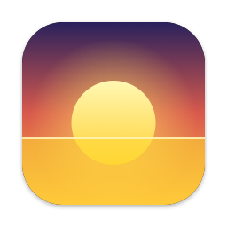

<p align="center"></p>

<h1 align="center">Filtre Jaune</h1>

<p align="center">Un filtre de lumière bleue pour Mac, dans la barre de menus.</p>

<p align="center"><a href="https://github.com/jordanthm26-stack/filtre-jaune/releases/latest"><b>⬇︎ Télécharger la dernière version</b></a></p>

---

Filtre Jaune teinte tout l'écran en jaune-orangé pour reposer les yeux le soir, comme f.lux.

- **Température** réglable de 1900 K (bougie) à 6500 K (neutre), avec 5 préréglages
- **Intensité** réglable de 10 à 100 %
- Deux méthodes : modification des couleurs de l'écran (comme f.lux) ou calque jaune transparent
- Fonctionne sur tous les écrans branchés, se réapplique après la veille
- Panneau dans la barre de menus ; clic droit sur l'icône pour allumer / éteindre
- Ouverture au démarrage du Mac en option

Mac Apple Silicon ou Intel, macOS 13 ou plus récent.

## Installation

1. Télécharge `FiltreJaune-1.0.dmg` depuis la [page des versions](https://github.com/jordanthm26-stack/filtre-jaune/releases/latest).
2. Ouvre le fichier et glisse **Filtre Jaune** dans **Applications**.
3. Lance l'app. L'app n'est pas encore validée par Apple : au premier lancement, macOS indique qu'elle ne peut pas être vérifiée. Va dans **Réglages Système → Confidentialité et sécurité**, puis clique sur **Ouvrir quand même**.

L'icône ☀︎ apparaît alors en haut à droite, dans la barre de menus.

## Compiler soi-même

```bash
./build.sh
```

Il faut les outils de développement Xcode (`xcode-select --install`). Le script produit l'app, un `.dmg` et un `.zip` dans `build/`.
